<div align="center">

# Pulso

**App de entrenamiento en casa para Android: rutinas, coach con voz, conteo de repeticiones con la cámara y un esquema de músculos interactivo.**

HTML · CSS · JavaScript · Android (Java, WebView) · Firebase · MediaPipe · TTS neuronal (Kokoro)

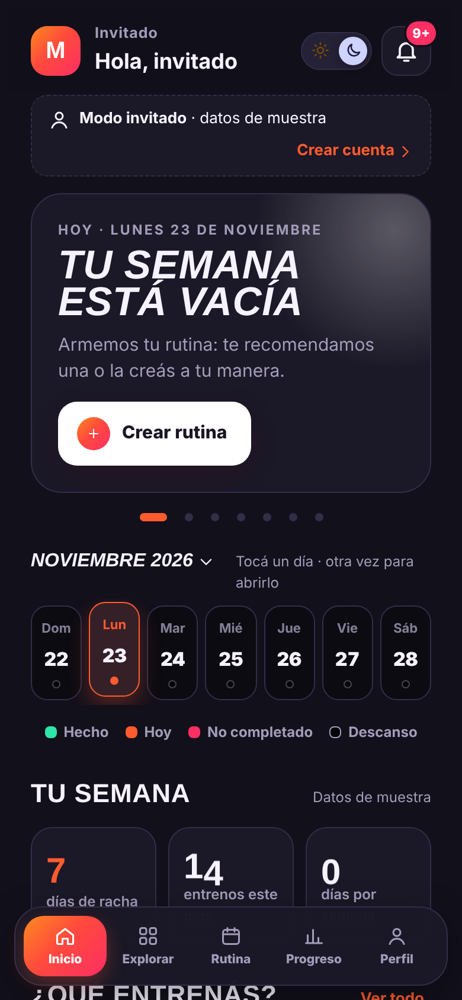 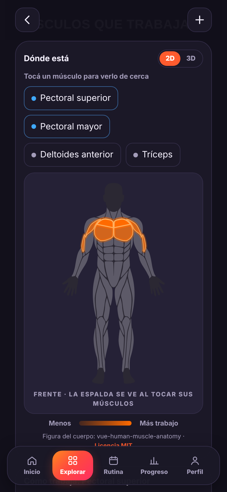 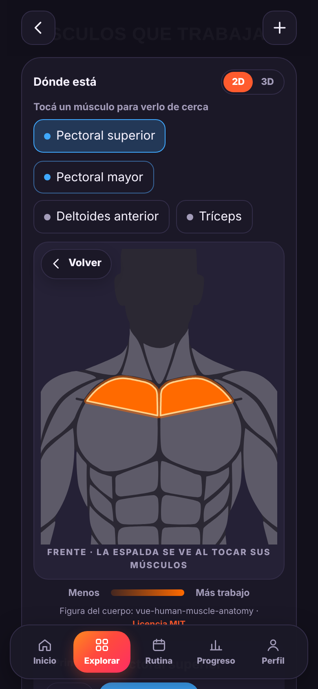

</div>

---

## Qué hace

| | |
|---|---|
| **Rutina semanal** | Armás qué grupo entrenás cada día. El inicio muestra la semana como un carrusel de días y el banner del día elegido. |
| **36 ejercicios y 17 estiramientos** | Cada ejercicio con pasos, consejo clave, figura animada que muestra el movimiento y clase guiada con voz. |
| **Esquema de músculos** | Figura de frente y espalda (hombre o mujer) donde los músculos que trabaja cada ejercicio se iluminan en naranja con más o menos intensidad. Al tocar un músculo se acerca con zoom y explica qué hace. Tiene vista 2D y 3D. |
| **Coach con voz** | 1.556 frases grabadas con voz neuronal (mujer y hombre) que funcionan sin internet: cuenta repeticiones, corrige la postura y motiva. |
| **Cámara** | Detecta el cuerpo con MediaPipe Pose, cuenta repeticiones y avisa errores de técnica (por ejemplo, poca profundidad en la sentadilla). |
| **Anatomía y elongación** | Ficha de cada músculo (porciones, qué ejercicio trabaja cada una, fuentes científicas) y sesiones guiadas de estiramientos. |
| **Progreso** | Calendario con días cumplidos, racha, historial por día, semana y mes. |
| **Recordatorios** | Notificaciones programadas que suenan aunque la app esté cerrada. |
| **Cuenta** | Ingreso con Google o email. Todo se sincroniza en la nube; también se puede usar sin cuenta. |

## Capturas

| Carga | Explorar | Ejercicio | Vista 3D |
|:-:|:-:|:-:|:-:|
|  | 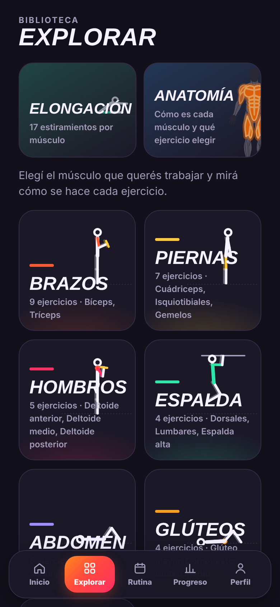 | 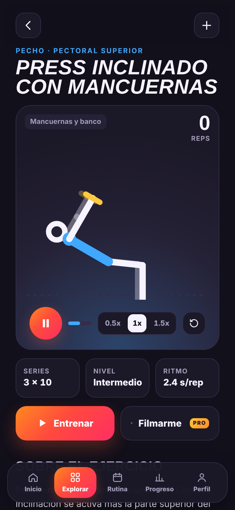 | 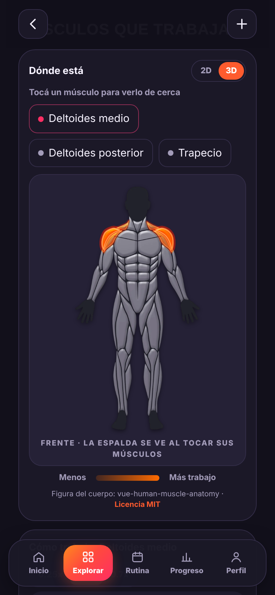 |
| **Músculos** | **Ficha de músculo** | **Estiramientos** | **Figura de mujer** |
| 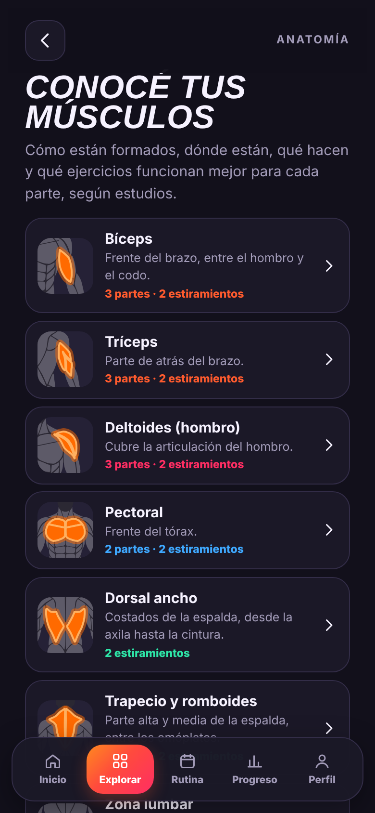 | 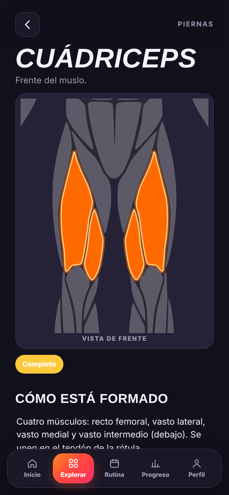 | 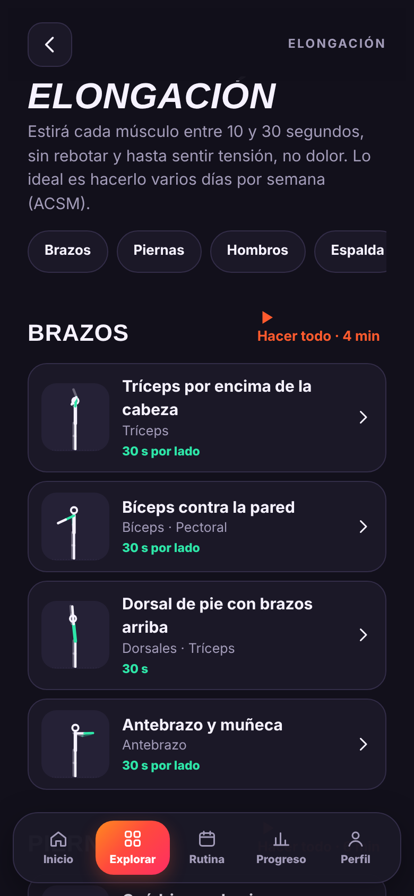 | 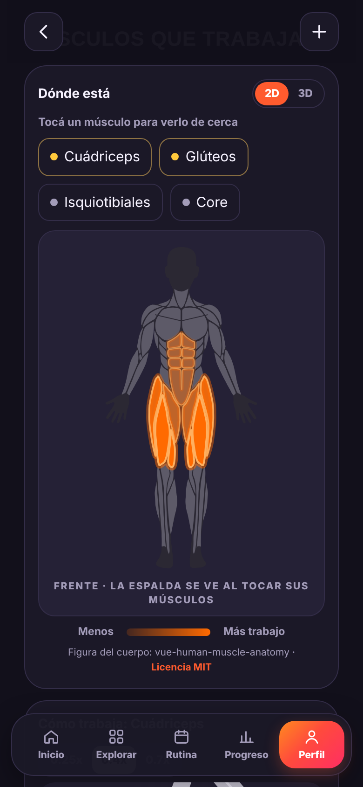 |
| **Progreso** | **Rutina** | **Perfil** | |
| 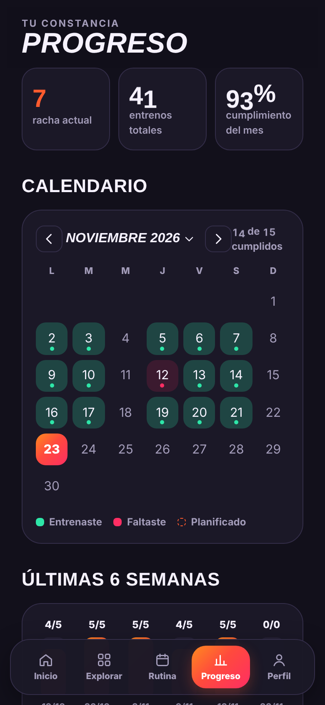 | 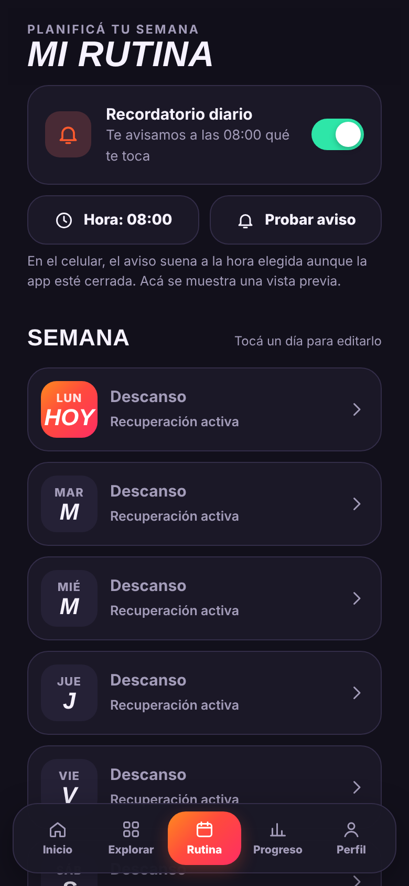 | 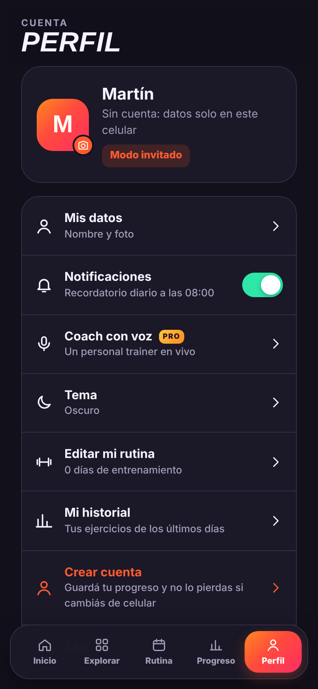 | |

## Tecnologías y por qué se eligieron

| Tecnología | Para qué | Por qué |
|---|---|---|
| **HTML + CSS + JavaScript sin framework** | Toda la interfaz (`app/pulso.html`) | Arranca rápido en celulares de gama baja, no necesita compilación y es fácil de leer de punta a punta. |
| **Android WebView + Java** | Contenedor de la app (`android/`) | Un solo código de interfaz para el celular y la web. Java se usa solo para lo nativo: notificaciones, voz, fotos, permisos e inicio de sesión con Google. |
| **Firebase Authentication + Firestore** | Cuentas y datos en la nube | Login con Google/email y base de datos sin mantener un servidor. Las reglas de seguridad (`firebase/firestore.rules`) aseguran que cada usuario solo vea lo suyo. |
| **MediaPipe Pose** | Detección del cuerpo con la cámara | Funciona en el celular (no envía video a ningún servidor) y da puntos 3D del cuerpo para medir ángulos. |
| **Kokoro-82M (TTS neuronal)** | Voz del coach | Voz natural en español, licencia Apache 2.0. Las frases se graban una vez y se reproducen sin internet. |
| **SVG** | Íconos, figuras animadas, esquema de músculos | Vectorial: se ve nítido con cualquier zoom y pesa poco. |
| **Playwright + Node.js** | Herramientas de desarrollo (`tools/`) | Generan el video de intro, el esquema muscular y las capturas a partir del código. |

## Cómo está armado

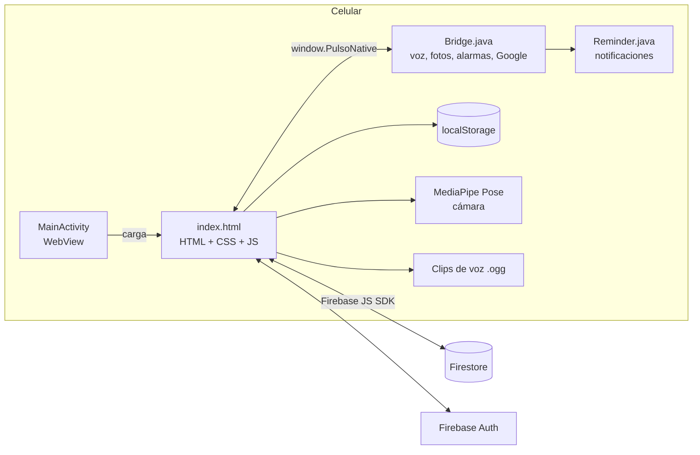

- **Un solo archivo de interfaz.** `app/pulso.html` tiene el diseño, los datos y la lógica. Cada pantalla es una función `V.nombre()` que devuelve HTML como texto; `render()` lo pone en pantalla.
- **Estado simple.** El objeto `S` guarda dónde está el usuario y qué eligió; `store` lo persiste en el celular y, con cuenta, en Firestore.
- **Eventos por delegación.** Los botones llevan `data-act="acción"` y un único listener decide qué hacer.
- **Puente nativo.** Lo que el navegador no puede hacer, lo hace Java (`Bridge.java`), y JavaScript lo llama con `window.PulsoNative`.

Más detalle en [docs/ARQUITECTURA.md](docs/ARQUITECTURA.md). Para aprender cómo se hizo, paso a paso: [docs/APRENDE.md](docs/APRENDE.md).

## Estructura del repositorio

```
app/pulso.html          Interfaz completa (HTML, CSS y JavaScript comentados)
android/                Proyecto Android (Gradle)
  app/src/main/java/    MainActivity, Bridge (puente JS <-> Android), Reminder (notificaciones)
  app/src/main/assets/  Voces del coach, figuras del cuerpo, video de intro
firebase/               Reglas de seguridad y esquema de datos
content/data.py         Contenido investigado: ejercicios, estiramientos y anatomía, con fuentes
tools/cuerpo/           Generador del esquema muscular (hombre/mujer, 2D/3D)
tools/voz/              Kit para grabar las frases del coach con voz neuronal
tools/intro/            Render del video de intro
scripts/build-apk.sh    Copia la interfaz al proyecto Android y genera el APK
docs/                   Arquitectura, guía de aprendizaje y capturas
```

## Probarlo

**En el navegador:** abrí `app/pulso.html` (la cámara y la voz neuronal funcionan mejor en el celular).

**Generar el APK** (necesita JDK 17, Android SDK y Gradle 8):

```bash
./scripts/build-apk.sh
# APK en android/app/build/outputs/apk/release/
```

Para firmar el APK, creá `android/keystore.properties` (no se sube al repositorio):

```
storeFile=../mi-clave.p12
storePassword=...
keyAlias=...
keyPassword=...
```

## Créditos y licencias de terceros

- Figura del cuerpo: [vue-human-muscle-anatomy](https://github.com/LucaWahlen/vue-human-muscle-anatomy) de Luca Wahlen (MIT), adaptada (pectoral dividido por porciones, vista 3D, figura según el perfil).
- Voces: [Kokoro-82M](https://huggingface.co/hexgrad/Kokoro-82M) (Apache 2.0).
- Detección de postura: [MediaPipe](https://developers.google.com/mediapipe) (Apache 2.0).
- Recorte de formas en el generador: [polygon-clipping](https://github.com/mfogel/polygon-clipping) (MIT).
- Tipografías: Barlow Condensed y Manrope (Google Fonts, SIL Open Font License).
- Fuentes científicas del contenido: listadas dentro de la app y en `content/data.py`.
